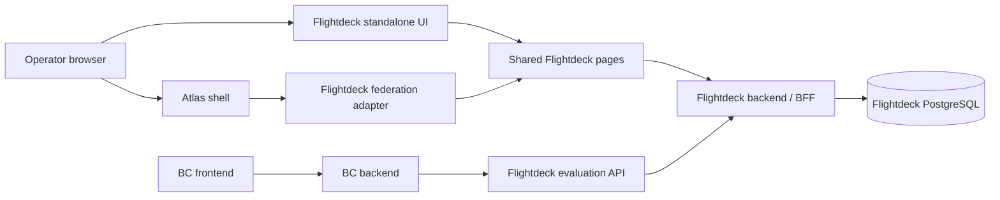

# Flightdeck architecture

Status: unified redesign locally verified. The replacement is deployment-local authoring, read-only master observation, environment-local lifecycle/metadata and current-published segment following. [Unified verification](stage-two-verification.md#unified-redesign-verification) records integrated checks and real browser/recording evidence separately from historical checkpoints. Production identity, operations and deployment gates remain open.

## Product boundary

Flightdeck manages enablements, feature release controls and experiments. It is an independently owned application and service. Atlas supplies shell composition, shared libraries and environment contracts. BC is a separate consumer, not the home of Flightdeck's implementation.

Use Unleash and Flagsmith as product references, not source dependencies or promises of complete parity. An enablement is the deliberate availability of a capability for a target population; initially model it through flag targeting rather than building a second evaluation engine. An experiment adds assignments, actual exposures, metrics and analysis; a percentage rollout alone is not an experiment.

## Runtime boundaries

The two API boxes are boundaries within one service initially, not independently deployed microservices. Start with one backend and database. Add an edge evaluator or independent event-processing service only when demonstrated requirements justify it.

### Flightdeck owns

- React/TypeScript frontend and TypeScript backend/BFF.
- Product domain, evaluation semantics and versioned REST contracts.
- PostgreSQL schema, migrations, restricted runtime role and audit history.
- Application authorization and consumer credentials.
- Container build, Helm chart, deployment package, tests and operator documentation.

### Atlas owns

- Shell, module-federation composition and published SDK/UI/BFF/build packages.
- Environment namespaces, approved workload identity, database/secrets bindings and network admission.
- Environment deployment execution and shell registration.

### BC owns

- Its user and tenant authorization, its backend adapter and its browser-facing behavior.
- Caller-selected safe fallback behavior for each integrated feature.
- Passing only approved, authenticated context to Flightdeck from its backend.

Flightdeck does not trust a tenant identifier merely because BC can reach its network endpoint. Credential scope and allowed context must be enforced by Flightdeck as well.

## Stack and integration

Implemented stack: TypeScript, React, Vite, Node's HTTP server, published Atlas BFF error utilities, PostgreSQL through `pg`, Zod-validated versioned OpenAPI contracts and Vitest behavior tests. The app owns its bounded request reader, loopback/origin checks and development-session verification rather than inheriting the demo BFF's unrestricted listener and shell-name authentication.

Use published `@onebrief/atlas-sdk`, `@onebrief/atlas-ui`, `@onebrief/atlas-bff-kit`, `@onebrief/atlas-vite-config` and the appropriate shell contract, with published `@onebrief/ux-kit` primitives. Keep all versions explicit and compatible as one set with the target shell. The Todo reference proved the `0.1.0` family with React `19.2.7` and Vite `8.2.1`; this is a starting compatibility candidate, not permission to choose independent latest releases.

The build must generate `atlas-app.json` from app metadata and expose the registration entry through the published federation configuration. A clean Flightdeck dependency install and build must not require Atlas or BC source. A separate, unmodified Atlas checkout is allowed to run the shell integration smoke scenario.

Standalone startup is the default product experience and must work without Atlas. Reuse the same domain pages behind an app-owned browser entry and a thin Atlas registration adapter. The inspected `defineAtlasRemote()` helper intentionally emits no `index.html`; it does not supply standalone startup. Build the standalone entry and federation remote to separate output directories so one build cannot erase the other's artifacts. The standalone entry owns its root toolkit styles and navigation; embedded pages defer those responsibilities to the shell.

The inspected SDK's `SessionUser` contains only `id`, `name` and `initials`, not organization membership or roles. The BFF kit's default shell-session introspection does not supply those missing authorization claims. Define a verified application identity boundary rather than assuming that a shell token is sufficient.

Private package installation requires approved Nexus read credentials outside the repository. Do not commit tokens, certificates or authenticated registry URLs. Publishing and deployment credentials are separate from package read credentials.

## Domain and scope

Implemented local domain (experiment records remain planned):

| Concept                    | Ownership and purpose                                                                                             |
| -------------------------- | ----------------------------------------------------------------------------------------------------------------- |
| Control-plane organization | Administrative security boundary for operators and projects; not implicitly a BC tenant                           |
| Project                    | Owns flag definitions, context schema and consumer bindings                                                       |
| Environment                | Independently scoped configuration such as development or production, within a project                            |
| Flag                       | Stable project-scoped key with independently reported environment-local metadata/lifecycle/archive state          |
| Environment configuration  | Local gate, typed values, rules, variants and a monotonic local flag revision                                     |
| Segment                    | Project/environment-scoped draft, current published definition and retained immutable published history           |
| Consumer credential        | Explicit organization/project/environment/operation and tenant grants; store a verifier, not a recoverable secret |
| Audit change               | Actor, scope, action, timestamp, before/after configuration and resulting revision                                |
| Experiment                 | Versioned hypothesis, allocation, variants, unit, metrics and analysis policy                                     |

Boolean, string, number and JSON values are supported. The value type belongs to an environment configuration; all its outcomes, variants and active overrides must agree. Keys are immutable and unique within a project. Name, description, owner, lifecycle, archive state and revisions are environment-local; creating a flag initializes only the configured local environment, Off. Lifecycle is `development`, `release`, `system` or `permissions`, with no automatic activation or age-based transition. Experiment records are not implemented.

`GET /api/v1/deployment` exposes server-owned mode, environment identity and approved dashboard links from `server/deployment.ts`. A local dashboard has one fixed environment and no environment selector or matrix. Server authorization enforces this boundary on every write, including project-only paths. Master compares actually stored reports by project/key and has no mutation or remote-request capability. A missing configuration remains unavailable; it is not an invented Off report.

The bounded project inventory supplies local summaries or read-only cross-environment reports without fetching full targeting snapshots per row. Master drill-down stays read-only; configured dashboard links hand off to a local dashboard without granting authorization. Multiple projects may exist within one deployment; a project is not an environment.

Separate three identities:

1. **Operator identity:** the authenticated person or workload managing configuration.
2. **Consumer identity:** the service allowed to evaluate a bounded project/environment.
3. **Evaluation subject:** the stable user, account or other unit being targeted or assigned, namespaced by trusted tenant context where applicable.

A BC user UUID is not automatically an Atlas person ID. A control-plane organization is not automatically a BC account. Define the mapping and delegation contract before using either in authorization or targeting.

## Authorization gate

Before Stage 1 accepts real organizational data, document the target identity issuer, signature verification, audience, organization membership and role claims. Do not treat shell registration, module federation, a selected display name or forwarded unsigned headers as authentication.

Operator permissions start with viewer, editor and administrator capabilities scoped to the organization/project; service evaluation permission is separate. Cross-organization reads, writes and enumeration must fail. Database queries include the authorized scope, not just a caller-supplied resource ID.

If the current shell only provides demo identity, a local-only demonstration may use an explicit isolated development identity configuration. It must be visibly labeled, bind to loopback, use disposable data and refuse production mode. It does not pass the production identity gate or permit real BC integration. There must be no automatic authentication downgrade.

Service credentials explicitly grant 1–20 tenant IDs. Evaluation requires a matching tenant before flag lookup; an arbitrary `tenantId` body field cannot expand the grant. The bootstrap credential permits only `local-tenant`. Custom traits remain asserted by the trusted backend in this local demonstration. Authoritative BC tenant/user mapping, delegated identity and production credential lifecycle are Stage 3/shared-environment gates, not proven by this allowlist.

## Evaluation contract

The [evaluation specification](evaluation-spec.md) defines exact precedence, missing-data behavior and the `sha256-v1` byte encoding. OpenAPI version `3.0.0` identifies the unified preproduction management-contract cutover; routes remain `/api/v1`. The typed POST evaluation wire contract remains provider-compatible and the provider is unchanged. GET evaluation remains removed. Integrated local verification is recorded separately from production qualification.

- Select project/environment from authorized consumer scope; reject a tenant outside credential grants before flag lookup.
- Precedence is archived → environment disabled → active exact tenant/subject override → first eligible ordered rule → configured default.
- Gates return the configured typed off value. `enabled` describes the environment master gate, not whether a returned boolean happens to be true.
- AND every rule condition and attached segment reference; within each segment, OR definition blocks and AND conditions inside each block. Missing/wrong-type values do not satisfy negated comparisons; presence/absence is explicit, with no coercion. `ends_with` is exact case-sensitive text suffix matching.
- Flag publication retains validated attribute definitions and attaches references to the current published local segments, not per-flag version pins. Saving catalog attributes or segment drafts does not publish behavior. Explicit segment publication advances every published local reference atomically, independently of flag publication.
- Rollout admission and variant selection have separate deterministic hash purposes. Immutable namespaces, stable IDs and integer basis points define allocation. Partial rollouts and every variant selection require tenant plus stable subject; full-rollout fixed values do not require a subject.
- All declared variants have weights totaling 10000 basis points. No automatic redistribution occurs. Current/draft previews and warnings expose assignment-sensitive changes; they are not population estimates or experiment results.
- Return a configuration revision and explainable reason. A permission failure, unknown key or malformed context is not a successful false evaluation.
- Start with server-side remote evaluation. Consumer clients require bounded requests, timeouts and explicit error behavior. A consumer may apply its declared fallback for an unavailable/unknown decision, but must not hide a failed authorization as ordinary targeting.
- Never prescribe global `false` as a safe failure policy. Some features are safety or access controls whose safe fallback differs. Flag evaluation is not a substitute for authorization or entitlement enforcement.

Permanent language-neutral vectors cover precedence, types, missing data, gates, expiry and allocation boundaries. The same evaluator serves backend decisions and operator previews. The backend client validates scope, key and tagged type, applies only its declared fallback for unavailable/unknown decisions, and throws on authorization failure. Evaluation does not persist a context/exposure row.

## Writes, audit and storage

Use PostgreSQL transactions for configuration changes, revision increments and audit records. Use expected revisions to reject lost updates rather than silently overwriting another operator's edit. Keep evaluation credentials read-only at the API boundary. Use separate migration and restricted runtime roles; parameterized SQL only.

Tables have explicit ownership and growth/index documentation in [local development](local-development.md). Inventory is bounded to 20 rows/page; activity, catalog history, credentials and override lists are bounded to 100. Configurations are bounded snapshots, not unbounded event streams.

Migration `002-targeting.sql` preserves existing flag IDs, enabled/archive state and revisions, adds typed boolean defaults, and restricts existing development credentials to `local-tenant`. Current catalogs and append-only catalog history are project-scoped. Overrides require exact environment/tenant/subject, owner, reason and expiry; runtime permits only revocation, not arbitrary mutation. Configuration/catalog/override writes are transactional with optimistic revision checks and audit records.

Migration `003-unified-design.sql` separates environment-local flag state, segment draft/current/history records and unified audit. Segment draft save and restore use optimistic revisions and do not change live references. Publication binds the reviewed draft and affected published-reference set: a concurrent attach/detach or relevant flag change invalidates stale review. It preserves gates, direct selections, flag revisions and unrelated drafts, records exact affected references atomically, clears the published draft and retains earlier published snapshots. Restore copies historical contents into a draft; it is never an immediate live rollback.

Segment publication also increments the environment catalog revision, without changing its attributes, to invalidate stale flag reviews. Built-in directory field types need no preparatory catalog mutation. Migration preserves original audit snapshots verbatim and records a separate `following_migrated` event for the pin-to-following cutover; old history is not rewritten as if it had always followed.

Segment history retention is independent of response size: records return the latest 20 definitions and `historyNextCursor`; the scoped segment-history endpoint pages older versions by `before` version and returns `items`/`nextCursor`. Audit before/after preserves event-time current publication, draft and usage while omitting accumulated history/page fields, avoiding quadratic history duplication. It does not discard the separately retained historical definitions.

Local policy retains configuration until explicit archival and retains audit/revoked override rows. Evaluation traits are not logged; stored override targets are intentional management data. Numeric retention, deletion obligations and backup/recovery objectives remain deployment gates. Experiment events/deduplication remain Stage 5.

## UI direction

The approved unified direction defines three peer views: Flags, Segments and Audit trail, with settings secondary. Audience and its inline editor occupy the full detail width; published-context testing has its own full-width row below. One compact audience search combines published Flightdeck segments with live BC people, organizations and groups, using typed filters, grouped results and one persistent chip list. Segment lookup filters the authorized environment catalog locally by name/key independently of directory availability; directory lookup retains its private source/tenant boundary and debounce. Segment chips follow current publication, not draft or pinned definitions. Create segment reuses the membership picker without nested-segment selection. Advanced controls occupies its own initially collapsed section below both blocks. One shared configuration editor owns the draft, undo, validation and advanced simulation state while rendering those separate surfaces. A single scoped Targeting change review modal validates the proposed snapshot; Cancel keeps the draft and only explicit Publish writes it. Lifecycle has its own local metadata review. Master is an observer, not a remote control plane.

Use Onebrief UX Kit and Atlas UI for actual components, density, typography, colors, focus behavior and accessibility. Shell-owned navigation stays in the shell; do not rebuild a competing shell. Distinguish configuration changes from runtime evaluation status. Require deliberate, scoped confirmation for risky production changes and show permission/validation errors rather than optimistic false success.

Audit uses the same bounded event response in two presentations: a full history table with whole-row event controls, then a compact date/action/object navigator beside immutable selected-event detail. No second history cache or live-object lookup supplies the compact labels. Short dates are explicitly UTC and retain full timestamps in accessible labels/tooltips and detail. Closing returns to the same filtered page and event control; scope/filter/page changes cannot leave an unrelated stale event open. Narrow layouts stack the compact list above detail without losing its bounded scrolling or the recorded before/after and affected-reference content.

The default Boolean authoring surface is **Everyone / Selected audiences**, with OR across selected Flightdeck segments and optional direct BC people, organization and group branches. It compiles to the same full-rollout ordered rules and false default; it is not a second flag engine. Typed values, arbitrary conditions, variants, partial rollouts and technical simulation stay mounted under **Advanced controls**, collapsed by default. A strict projection refuses to rewrite non-representable configurations. Missing or stale selected IDs are preserved, not silently dropped.

The optional directory is an authoring connection, not a membership replica or evaluation dependency. Without configuration its pickers remain disconnected. Configured status describes a binding, not a successful health check; failed searches/resolves surface errors rather than fabricated records.

### Optional directory integration and consumer-supplied context

The implemented authoring and consumer contracts have separate responsibilities:

- **Authoring:** editor/admin operators can search people by email and organizations/groups by name, then resolve saved IDs through the BFF. Viewers can read connection status only. Private server configuration binds each connection to a project/environment, actual BC tenant and source. The browser receives neither credentials nor upstream URLs. People use canonical lowercase UUIDs; organization/group IDs are canonical positive decimal strings; BC tenant GUIDs normalize to lowercase. Labels are lookup/display data, not identity.
- **Evaluation:** BC's backend supplies approved identity and effective membership context. Flightdeck evaluates saved generic rules without calling BC's directory. Directory outages affect new searches and label refreshes, not evaluation. The separate consumer adapter uses fresh actual-tenant admission metadata, never a browser projection; unassigned/foreign tenants retain legacy BC behavior without a Flightdeck network request.
- **Generic targeting:** each direct branch includes `tenantId` and `sourceId` equality guards, then `subjectId in` for people or `organizationIds`/`groupIds contains_any` for memberships. These fields have built-in types; incompatible declared types are rejected, and no manual catalog preparation is required for directory selections. Custom traits use the environment-local catalog. Branches OR with segments whose people/membership alternatives and trait blocks save as drafts before separate publication. Effective memberships follow the person across organizations; active organization does not narrow them. A singular current-organization trait remains distinct and must be server-validated.
- **Ownership:** BC owns accounts, organizations, groups and memberships; Flightdeck owns segment definitions. No group-member synchronization or per-evaluation directory callback is introduced. The supported BC directory credential/search/resolve API is a separate BC PR prerequisite, not a released BC capability or production onboarding guarantee.
- **OpenFeature:** the [evaluation-context specification](https://openfeature.dev/specification/sections/evaluation-context/) supplies a targeting key and custom fields, not BC field names, a directory protocol or management UI. The independent `@flightdeck/openfeature-provider` package implements the server SDK provider interface with the supported context mapping and error/default policy documented in the [evaluation specification](evaluation-spec.md#openfeature-server-provider). Actual SDK calls are tested; no universal context support, certification or other-language provider is claimed.

The reusable loopback consumer lab at port 4722 owns a small backend, known synthetic personas and an independently built Onebrief-toolkit frontend. It consumes real persisted Sandbox configuration through the provider. The browser selects only known persona/capability/scenario IDs; the backend supplies source, tenant, canonical synthetic subject and memberships. Recovery fixtures are explicitly labeled simulated transports; denied-tenant and invalid-credential scenarios call Flightdeck itself. Seeding preserves existing flags/configuration and stores the evaluation credential privately, separately from management sessions.

The separate BC change selects only `HOMEPAGE_CARDS_SHARED_TEXT_FILTER` → `bc-homepage-title-filter` on authenticated flag bootstrap. It reuses BC's canonical account UUID and effective organization/group memberships, converts organization/group IDs to strings, and checks fresh actual-tenant admission metadata against the configured binding before calling Flightdeck. A deployment binding is not an organization or an inferred current organization. Integration is disabled by default; unconfigured/anonymous/unassigned/foreign-tenant paths and all other BC flags retain BC evaluation without a Flightdeck request. Recoverable failures use the existing BC-evaluated Boolean; authorization and invalid-context errors fail explicitly. There is no decision cache: a managed update is visible on the next successful bootstrap/page refresh, not a new push-notification guarantee.

## Deployment boundary

Flightdeck builds its own image and service-owned Helm/install declarations. Atlas admits environment resources and executes approved digest-pinned UDS bundles through its enterprise repository. Do not revive the retired service-dispatch intake or assume a personal GitHub repository can assume Atlas's deployment role.

Start onboarding in Stage 1 while building locally. Shared deployment requires namespace and scoped permissions, database roles and secrets, migration execution, explicit shell/service/database/BC network rules, routing, app discovery, artifact publishing, recovery policy and identity integration. A browser working locally does not prove any of those bindings.

## Evidence sources

The inspected checkout revisions are recorded so later stages can detect drift. Local paths are reference material, never runtime dependencies.

| Reference                                                    | Inspected revision                         | Relevant paths                                                                                        |
| ------------------------------------------------------------ | ------------------------------------------ | ----------------------------------------------------------------------------------------------------- |
| [Atlas](https://git.onebrief.tools/Onebrief/atlas)           | `d7005481cefb2668d56b780137f2429f7cc094af` | `docs/npm-packages.md`, `docs/app-artifacts.md`, `docs/deployment-boundaries.md`, `src/packages/`     |
| [Atlas Todo](https://github.com/justin-morris-ob/atlas-todo) | `b129e9e2969138598bc440cbf9fe0c77e9374b23` | `README.md`, `package.json`, `src/register.tsx`, `scripts/shell.mjs`                                  |
| [Unleash](https://github.com/Unleash/unleash)                | `6e416ef757455bbf531661ef73fec61d33539055` | Feature domain and frontend workflows; detailed comparison in the plan                                |
| [Flagsmith](https://github.com/Flagsmith/flagsmith)          | `45cfd1026a35deeab3454de56aeb2c88877451c7` | Feature/environment/segment/identity model and product documentation; detailed comparison in the plan |

[Current feature requirements](conformance/feature-flags/README.md) describe implemented local behavior. Later-stage designs above are not passing conformance claims. Container/image/chart ownership is a future delivery responsibility, not evidence that those deployment artifacts exist today.
