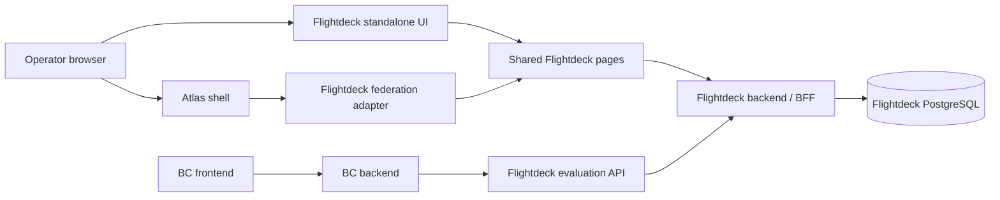

# Flightdeck architecture

Status: Stage 1 is implemented and locally exercised for boolean flags. This document also describes later-stage design decisions and production gates; see [the verification record](stage-one-verification.md) and [the stage plan](plan.md) to distinguish shipped behavior from planned capabilities.

## Product boundary

Flightdeck manages enablements, feature release controls and experiments. It is an independently owned application and service. Atlas supplies shell composition, shared libraries and environment contracts. BC is a separate consumer, not the home of Flightdeck's implementation.

Use Unleash and Flagsmith as product references, not source dependencies or promises of complete parity. An enablement is the deliberate availability of a capability for a target population; initially model it through flag targeting rather than building a second evaluation engine. An experiment adds assignments, actual exposures, metrics and analysis; a percentage rollout alone is not an experiment.

## Runtime boundaries

The two API boxes are boundaries within one service initially, not independently deployed microservices. Start with one backend and database. Add an edge evaluator or independent event-processing service only when demonstrated requirements justify it.

### Flightdeck owns

- React/TypeScript frontend and TypeScript backend/BFF.
- Product domain, evaluation semantics and versioned REST contracts.
- PostgreSQL schema, migrations, restricted runtime role and audit history.
- Application authorization and consumer credentials.
- Container build, Helm chart, deployment package, tests and operator documentation.

### Atlas owns

- Shell, module-federation composition and published SDK/UI/BFF/build packages.
- Environment namespaces, approved workload identity, database/secrets bindings and network admission.
- Environment deployment execution and shell registration.

### BC owns

- Its user and tenant authorization, its backend adapter and its browser-facing behavior.
- Caller-selected safe fallback behavior for each integrated feature.
- Passing only approved, authenticated context to Flightdeck from its backend.

Flightdeck does not trust a tenant identifier merely because BC can reach its network endpoint. Credential scope and allowed context must be enforced by Flightdeck as well.

## Stack and integration

Implemented Stage 1 stack: TypeScript, React, Vite, Node's HTTP server, published Atlas BFF error utilities, PostgreSQL through `pg`, Zod-validated versioned OpenAPI contracts and Vitest behavior tests. The app owns its bounded request reader, loopback/origin checks and development-session verification rather than inheriting the demo BFF's unrestricted listener and shell-name authentication.

Use published `@onebrief/atlas-sdk`, `@onebrief/atlas-ui`, `@onebrief/atlas-bff-kit`, `@onebrief/atlas-vite-config` and the appropriate shell contract, with published `@onebrief/ux-kit` primitives. Keep all versions explicit and compatible as one set with the target shell. The Todo reference proved the `0.1.0` family with React `19.2.7` and Vite `8.2.1`; this is a starting compatibility candidate, not permission to choose independent latest releases.

The build must generate `atlas-app.json` from app metadata and expose the registration entry through the published federation configuration. A clean Flightdeck dependency install and build must not require Atlas or BC source. A separate, unmodified Atlas checkout is allowed to run the shell integration smoke scenario.

Standalone startup is the default product experience and must work without Atlas. Reuse the same domain pages behind an app-owned browser entry and a thin Atlas registration adapter. The inspected `defineAtlasRemote()` helper intentionally emits no `index.html`; it does not supply standalone startup. Build the standalone entry and federation remote to separate output directories so one build cannot erase the other's artifacts. The standalone entry owns its root toolkit styles and navigation; embedded pages defer those responsibilities to the shell.

The inspected SDK's `SessionUser` contains only `id`, `name` and `initials`, not organization membership or roles. The BFF kit's default shell-session introspection does not supply those missing authorization claims. Define a verified application identity boundary rather than assuming that a shell token is sufficient.

Private package installation requires approved Nexus read credentials outside the repository. Do not commit tokens, certificates or authenticated registry URLs. Publishing and deployment credentials are separate from package read credentials.

## Domain and scope

Proposed conceptual model, to be translated into a reviewed migration in Stage 1:

| Concept                    | Ownership and purpose                                                                                       |
| -------------------------- | ----------------------------------------------------------------------------------------------------------- |
| Control-plane organization | Administrative security boundary for operators and projects; not implicitly a BC tenant                     |
| Project                    | Owns flag definitions, context schema and consumer bindings                                                 |
| Environment                | Independently scoped configuration such as development or production, within a project                      |
| Flag                       | Stable project-scoped key, description, owner and lifecycle metadata                                        |
| Environment configuration  | Enabled state, off variation, rules, variants and a monotonic revision for a flag/environment               |
| Segment                    | Reusable, typed targeting conditions within an explicit project scope                                       |
| Consumer credential        | Explicit organization/project/environment/operation permissions; store a verifier, not a recoverable secret |
| Audit change               | Actor, scope, action, timestamp, before/after configuration and resulting revision                          |
| Experiment                 | Versioned hypothesis, allocation, variants, unit, metrics and analysis policy                               |

Start with boolean flags. Add typed values, segments, overrides, rules, variants and experiment records only in their corresponding stages. Keys must have a documented uniqueness scope and rename policy; do not use display names as immutable identifiers.

Separate three identities:

1. **Operator identity:** the authenticated person or workload managing configuration.
2. **Consumer identity:** the service allowed to evaluate a bounded project/environment.
3. **Evaluation subject:** the stable user, account or other unit being targeted or assigned, namespaced by trusted tenant context where applicable.

A BC user UUID is not automatically an Atlas person ID. A control-plane organization is not automatically a BC account. Define the mapping and delegation contract before using either in authorization or targeting.

## Authorization gate

Before Stage 1 accepts real organizational data, document the target identity issuer, signature verification, audience, organization membership and role claims. Do not treat shell registration, module federation, a selected display name or forwarded unsigned headers as authentication.

Operator permissions start with viewer, editor and administrator capabilities scoped to the organization/project; service evaluation permission is separate. Cross-organization reads, writes and enumeration must fail. Database queries include the authorized scope, not just a caller-supplied resource ID.

If the current shell only provides demo identity, a local-only demonstration may use an explicit isolated development identity configuration. It must be visibly labeled, bind to loopback, use disposable data and refuse production mode. It does not pass the production identity gate or permit real BC integration. There must be no automatic authentication downgrade.

The service-to-service contract must define how a BC credential's scope restricts permitted tenant subjects. An arbitrary `tenantId` body field cannot grant access. Rotation and revocation are mandatory before shared-environment usage.

## Evaluation contract

Stage 1 has only boolean enabled/off evaluation; Stage 2 introduces the richer semantics below. Freeze exact input/output schemas and examples before implementing either stage.

- Select the project/environment from authorized consumer scope; reject attempts to expand it through request parameters.
- A known flag disabled in that environment returns its defined off value and a disabled reason. It cannot be re-enabled by a targeting override.
- A targeting override, ordered rules and a default outcome need explicit precedence. Recommended starting precedence: environment disable, explicit subject override, first matching ordered rule, then configured default outcome.
- Inside a rule, all conditions must match; alternative rules provide OR semantics. Missing attributes do not satisfy a condition, including negated operators, unless an explicit presence/absence operator requests that behavior.
- Validate attribute types and operators at authoring time; do not silently coerce strings into booleans or numbers.
- Percentage allocation uses a documented, versioned deterministic hash, stable subject key, flag/experiment salt and bucket range. Do not use request-time randomness. Specify behavior when the stickiness key is missing; the initial recommendation is no percentage-rule match with an explainable reason.
- Variants have stable IDs, validated weights and a deterministic assignment separate from the enabled/off decision. Configuration edits must have defined effects on assignment and experiment eligibility.
- Return a configuration revision and explainable reason. A permission failure, unknown key or malformed context is not a successful false evaluation.
- Start with server-side remote evaluation. Consumer clients require bounded requests, timeouts and explicit error behavior. A consumer may apply its declared fallback for an unavailable/unknown decision, but must not hide a failed authorization as ordinary targeting.
- Never prescribe global `false` as a safe failure policy. Some features are safety or access controls whose safe fallback differs. Flag evaluation is not a substitute for authorization or entitlement enforcement.

Record missing/malformed context handling, precedence, numeric boundaries, percentage boundaries, changes in rollout percentage and variant reassignment in permanent behavior tests when implemented. Evaluation must not create one durable row per request by default.

## Writes, audit and storage

Use PostgreSQL transactions for configuration changes, revision increments and audit records. Use expected revisions to reject lost updates rather than silently overwriting another operator's edit. Keep evaluation credentials read-only at the API boundary. Use separate migration and restricted runtime roles; parameterized SQL only.

Every table needs a documented owner, access pattern, index, expected growth and retention rule at introduction. Start with a project/environment-scoped list ordered by an indexed stable key and bounded pagination. Do not hide unbounded history, contexts or event streams in JSON columns.

Proposed policy for initial development: retain active configuration until explicit archival; archive flags without immediately removing referenced keys; audit history is append-only through runtime APIs and may contain only allowlisted configuration metadata. Do not retain raw evaluation subject/context data by default. Decide numeric retention periods, deletion obligations and backup/recovery objectives with the deployment owner before admitting shared or production data. Experiment event retention and deduplication are separate Stage 5 decisions.

## UI direction

Borrow Unleash's information hierarchy: project/environment navigation, a searchable flag inventory, clear per-environment state and a flag detail view with configuration, targeting, variants and activity as those capabilities arrive. Use focused create/edit flows, readable rule summaries and an evaluation playground before a complex visual rule builder.

Use Onebrief UX Kit and Atlas UI for actual components, density, typography, colors, focus behavior and accessibility. Shell-owned navigation stays in the shell; do not rebuild a competing shell. Distinguish configuration changes from runtime evaluation status. Require deliberate, scoped confirmation for risky production changes and show permission/validation errors rather than optimistic false success.

## Deployment boundary

Flightdeck builds its own image and service-owned Helm/install declarations. Atlas admits environment resources and executes approved digest-pinned UDS bundles through its enterprise repository. Do not revive the retired service-dispatch intake or assume a personal GitHub repository can assume Atlas's deployment role.

Start onboarding in Stage 1 while building locally. Shared deployment requires namespace and scoped permissions, database roles and secrets, migration execution, explicit shell/service/database/BC network rules, routing, app discovery, artifact publishing, recovery policy and identity integration. A browser working locally does not prove any of those bindings.

## Evidence sources

The inspected checkout revisions are recorded so later stages can detect drift. Local paths are reference material, never runtime dependencies.

| Reference                                                    | Inspected revision                         | Relevant paths                                                                                        |
| ------------------------------------------------------------ | ------------------------------------------ | ----------------------------------------------------------------------------------------------------- |
| [Atlas](https://git.onebrief.tools/Onebrief/atlas)           | `d7005481cefb2668d56b780137f2429f7cc094af` | `docs/npm-packages.md`, `docs/app-artifacts.md`, `docs/deployment-boundaries.md`, `src/packages/`     |
| [Atlas Todo](https://github.com/justin-morris-ob/atlas-todo) | `b129e9e2969138598bc440cbf9fe0c77e9374b23` | `README.md`, `package.json`, `src/register.tsx`, `scripts/shell.mjs`                                  |
| [Unleash](https://github.com/Unleash/unleash)                | `6e416ef757455bbf531661ef73fec61d33539055` | Feature domain and frontend workflows; detailed comparison in the plan                                |
| [Flagsmith](https://github.com/Flagsmith/flagsmith)          | `45cfd1026a35deeab3454de56aeb2c88877451c7` | Feature/environment/segment/identity model and product documentation; detailed comparison in the plan |

No Flightdeck conformance documents existed at repository creation. [Stage 1 feature requirements](conformance/feature-flags/README.md) now describe implemented local behavior; later-stage designs above are not passing conformance claims.
